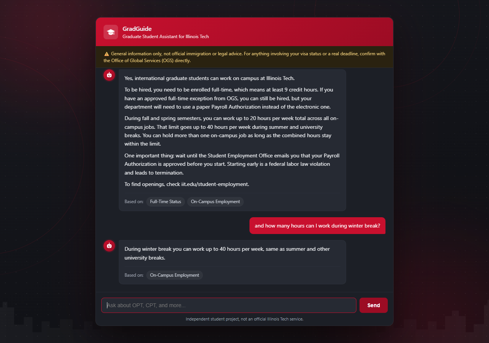
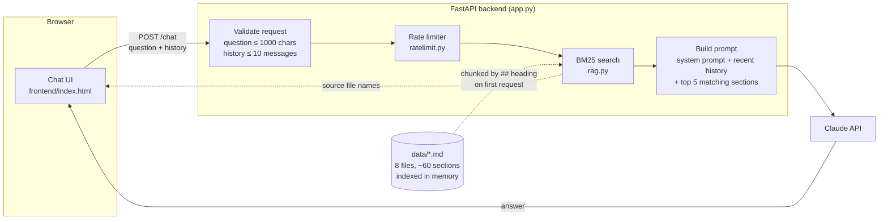
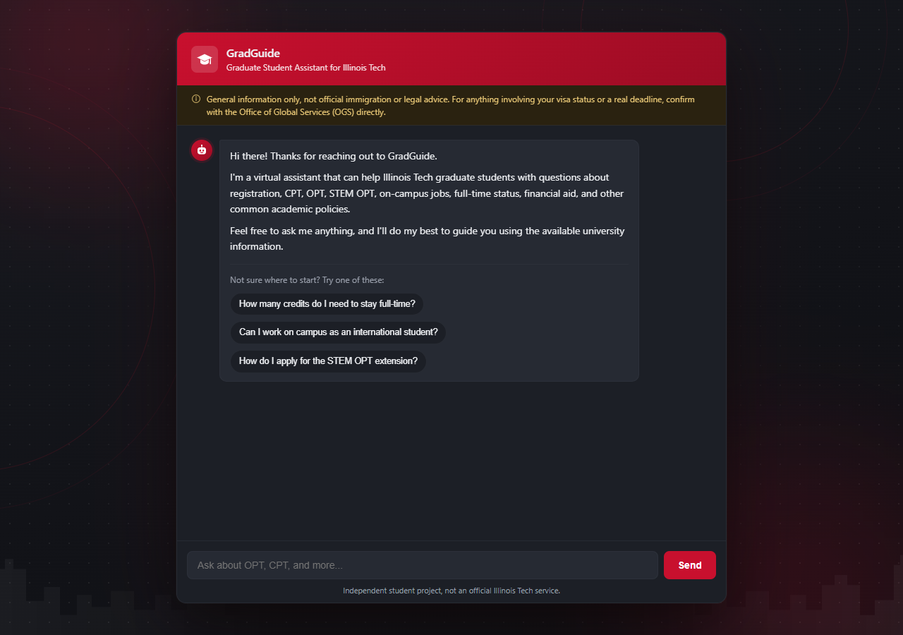
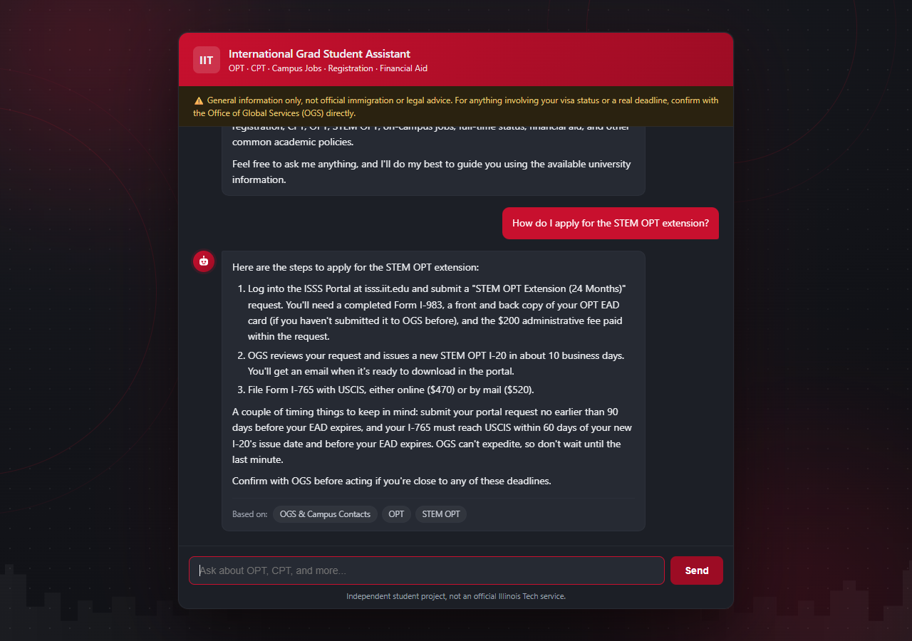
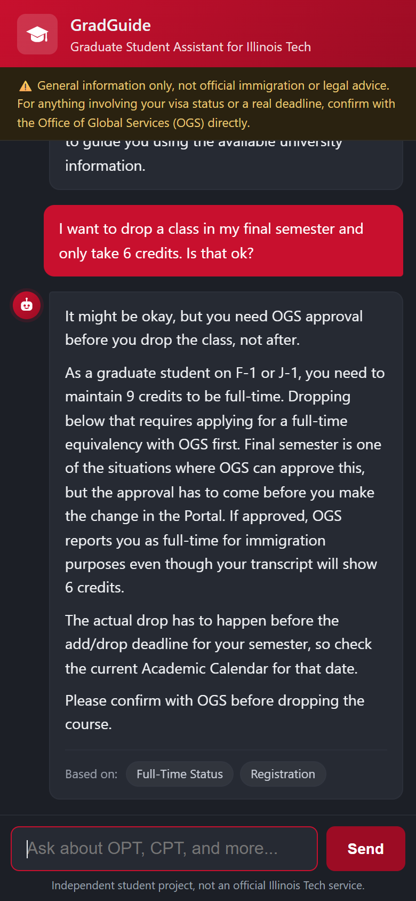

# International Grad Student Assistant for Illinois Tech

A chatbot that answers international grad students' questions about OPT, STEM OPT, CPT, on-campus jobs, registration, full-time status, and financial aid at Illinois Tech, using answers pulled from the university's own pages.

Built by [Vishal K Badgujar](https://www.linkedin.com/in/vishal-k-badgujar-b8115a200/) ([portfolio](https://vishal-portfolio-ten-sooty.vercel.app/))



## A note before anything else

This is not official immigration advice, and it shouldn't be treated that way. It's a tool for general orientation, the kind of thing you'd ask a senior student, not an immigration lawyer. Anything touching your actual visa status or a real deadline should go through the Office of Global Services (OGS) directly. The bot is told to say it doesn't know rather than guess, and to point status-related questions back to OGS, but I wouldn't want anyone treating an AI's answer as the final word on something that could affect their status. That's why the disclaimer sits at the top of the chat window, not just down here.

It's also an independent student project. It isn't affiliated with, endorsed by, or run by Illinois Tech, and the chat window says so at the bottom. For the same reason it doesn't use the university's seal or logos, which Illinois Tech reserves for its own colleges and offices.

## The problem

As an international student, the answers you need are spread across a dozen pages: OGS has CPT and OPT, Graduate Academic Affairs has registration and full-time rules, Student Employment has the on-campus job rules, Student Accounting has payment plans. Some of them change every semester. I spent a lot of time digging through those pages for questions like "can I drop to 6 credits in my last semester?" and figured other students hit the same wall.

## What I built

A small retrieval-augmented chatbot. I wrote eight short knowledge-base files in `data/` from the official pages (each one lists its source URLs and a "last verified" date). When you ask a question, the app finds the most relevant sections of those files and hands them to Claude with strict instructions: answer only from these notes, say plainly when something isn't covered, and point to the right office.

What it does:

- Answers from the knowledge base and shows which topics each answer is based on ("Based on: OPT, STEM OPT")
- Says "I don't have reliable information on that" instead of filling gaps from general knowledge, and doesn't invent URLs, fees, or dates
- Handles follow-ups ("what about OPT?") by sending the last few turns of the conversation along with each question
- Greets students with a short intro and starter questions, and shows a typing-style loader while it looks things up
- Writes in plain, conversational language: no headings, walls of bold text, or emojis, and it only adds an OGS reminder when a question actually touches visa status
- Works on phones as well as desktop
- Rate-limits requests per user and globally, so a script can't run up the API bill
- Has unit tests for retrieval, the API, and the rate limiter, plus an evaluation script that grades real answers

## How it works



Step by step:

1. **Knowledge base.** `ingest.py` splits each file in `data/` at its `##` headings, so every chunk is one topic (e.g. "STEM OPT: Application Steps"). Each chunk keeps its document title and "last verified" date. This happens in memory the first time a question comes in; there's no database or build step.
2. **Retrieval.** `rag.py` ranks the chunks against the question with BM25, a classic keyword relevance score, plus a small synonym list for everyday phrasings ("cost" → "fee", "TA" → "teaching assistantship"). For a follow-up, the previous question is added to the search so the topic carries over. Off-topic questions ("what's the capital of France?") match nothing, and the bot politely redirects.
3. **Generation.** The top matches go to Claude inside `<reference_notes>`, along with the last few turns of the conversation. The system prompt in `rag.py` handles grounding, tone, and formatting. It's worth reading if you want to see how "only answer from the notes" is actually enforced rather than just claimed.
4. **Response.** The API returns the answer plus the source file names. The frontend renders the answer with a small built-in markdown converter (numbered steps, links, the occasional bold) and turns the file names into readable labels like "STEM OPT" or "On-Campus Employment" (hover a label to see the file).

### Why BM25 and not embeddings?

I started with sentence-transformer embeddings in ChromaDB. With a knowledge base this small, keyword search finds the right section just as reliably: the tests in `tests/test_rag.py` check that 16 typical questions get the right section in the top 3. Dropping PyTorch and the vector database took the install from several gigabytes to about 66 MB and the first response from over 40 seconds to around 5. If the knowledge base grows a lot, embeddings would be worth bringing back.

## Screenshots

These were captured from the app running locally (`uvicorn app:app`) with real answers from the model.

| Welcome message | Numbered steps (STEM OPT) |
|---|---|
|  |  |

On a phone, answering whether a student can drop to 6 credits in their final semester:



## Project layout

```
iit-grad-assistant/
├── app.py                  # FastAPI app: /chat, /health, serves the UI, error handling
├── rag.py                  # BM25 retrieval, prompt building, Claude call
├── ingest.py               # Loads and chunks data/ (run it to see the chunks)
├── ratelimit.py            # In-memory sliding-window rate limiter
├── frontend/index.html     # Chat UI, plain HTML/CSS/JS, no build step
├── data/                   # Knowledge base, one markdown file per topic
├── tests/                  # Unit tests (Claude is mocked, no API key needed)
├── eval/
│   ├── test_questions.json # 20 questions with expected answers, including
│   │                        # off-topic, follow-up, and "not in the docs" cases
│   └── evaluate.py         # Runs the real pipeline and grades every answer
├── docs/screenshots/       # Screenshots used in this README
├── .github/workflows/
│   ├── tests.yml           # Unit tests on every push
│   └── eval.yml            # Full evaluation, started by hand (uses API credits)
├── Dockerfile
├── requirements.txt
└── requirements-dev.txt    # Adds pytest
```

## Running it locally

You'll need Python 3.10 or newer and an Anthropic API key (from console.anthropic.com).

```bash
python -m venv .venv
source .venv/bin/activate        # on Windows: .venv\Scripts\activate
pip install -r requirements.txt

cp .env.example .env             # on Windows: copy .env.example .env
# then open .env and set ANTHROPIC_API_KEY

uvicorn app:app --reload
```

Open http://localhost:8000 and start asking questions. `http://localhost:8000/health` should return `{"status": "ok"}`.

If you edit anything in `data/`, restart the server to pick it up. `python ingest.py` prints how the files get chunked if you want to check a change.

### Settings

Only `ANTHROPIC_API_KEY` is required. The rest are optional environment variables (also listed in `.env.example`):

| Variable | Default | What it does |
|---|---|---|
| `ANTHROPIC_MODEL` | `claude-sonnet-4-6` | Claude model used for answers |
| `RATE_LIMIT_PER_MINUTE` | `8` | Questions per minute from one IP |
| `RATE_LIMIT_PER_DAY` | `60` | Questions per day from one IP |
| `RATE_LIMIT_GLOBAL_PER_HOUR` | `300` | Questions per hour from everyone combined |
| `TRUST_PROXY_HEADERS` | `true` on Vercel, `false` elsewhere | Read the client IP from `X-Forwarded-For`. Vercel overwrites that header with the real visitor IP, so it's trusted there automatically. Elsewhere, turn it on only behind a proxy that sets it, otherwise people can fake their IP to dodge the limit |
| `ALLOWED_ORIGINS` | none | Comma-separated origins for CORS, only needed if the UI is hosted on a different domain than the API |

The rate limiter keeps its counts in memory. On a single server that's exact; on a serverless host each running instance counts separately, so treat it as a guard rail rather than a hard cap.

## Testing

Unit tests (free, Claude is mocked out):

```bash
pip install -r requirements-dev.txt
pytest
```

These cover chunking, retrieval for typical questions, follow-ups, off-topic questions, prompt building, input validation, error handling (rate limits, API outages, bad keys), and the rate limiter.

Evaluation against the real model (costs a few cents per run):

```bash
python eval/evaluate.py
```

This runs the 20 questions in `eval/test_questions.json` through the full pipeline and checks every answer three ways:

- **Grounded:** is every fact supported by the notes the bot was given? (graded by Claude)
- **Correct:** does it match the expected answer? (graded by Claude)
- **Style:** no em dashes, headings, bold, or emojis, and under 250 words (checked with plain code)

It exits with an error if any pass rate falls below its threshold, and prints the full answer for anything that fails so you can tell a real mistake from an overly strict grader. Scores vary a little between runs since the model isn't deterministic.

On GitHub, `tests.yml` runs the unit tests on every push. `eval.yml` only runs when you start it from the Actions tab, so ordinary pushes don't spend API credits; it needs an `ANTHROPIC_API_KEY` repository secret.

## Deploying

The backend is a small FastAPI app that serves the UI itself, so frontend and backend deploy together. Set `ANTHROPIC_API_KEY` on whatever host you use (and `TRUST_PROXY_HEADERS=true` if it sits behind a proxy that sets `X-Forwarded-For`).

### Vercel

Vercel picks up `app.py` automatically as a FastAPI app, so there's no build step. Import the GitHub repo in the Vercel dashboard (or run `vercel deploy`), then add `ANTHROPIC_API_KEY` under Project Settings, Environment Variables. The key stays on the server; the browser only ever talks to `/chat`.

The repo includes the few settings it needs:

- `vercel.json` caps each request at 60 seconds. The Claude client is set to give up after about 50 seconds in the worst case, and the browser after 60, so nobody pays for an answer no one is waiting for.
- `.python-version` pins Python 3.12, the same version CI tests on.
- `.vercelignore` keeps `.env`, local caches, tests, and docs out of the upload.

On Vercel the rate limiter reads the visitor's IP from `X-Forwarded-For` automatically. Its counts live in each running instance's memory, so for a hard ceiling on cost, also set a monthly spend limit in the Anthropic Console.

### Docker

```bash
docker build -t iit-grad-assistant .
docker run -p 8000:8000 --env-file .env iit-grad-assistant
```

`.dockerignore` keeps `.env` out of the image; the key is passed in when the container starts.

## Where the data comes from, and why it'll go stale

The files in `data/` were written from Illinois Tech's OGS, Graduate Academic Affairs, Student Employment, Student Accounting, and Financial Aid pages, plus the federal Study in the States, ICE, and FAFSA pages for a few federal rules (OPT unemployment limits, the CPT/OPT 12-month rule, federal aid eligibility). Everything was last checked in October 2026. Each file lists its exact source URLs at the top.

University rules change, sometimes a lot: in 2026, Illinois Tech paused CPT processing for programs without a required practical-training component. Fees and deadlines shift every semester too. So treat this as a starting point, re-check the source pages before relying on anything time-sensitive, and update the files (and the "last verified" date) when things change.

## What I'd add next

- More topics students ask about: travel signatures, grace periods after graduation, SSN applications, H-1B cap-gap
- A way to flag stale files automatically, e.g. a scheduled job that checks the source pages for changes
- Tracing (LangSmith or similar) to see what gets retrieved for real questions
- A shared rate-limit store (like Redis) if this ever runs on several servers
- Embeddings or pgvector if the knowledge base grows past what keyword search handles well

## Tech stack

Python, FastAPI, BM25 retrieval (pure Python), Claude API (Anthropic Python SDK), vanilla HTML/CSS/JavaScript, pytest, Docker, GitHub Actions.
